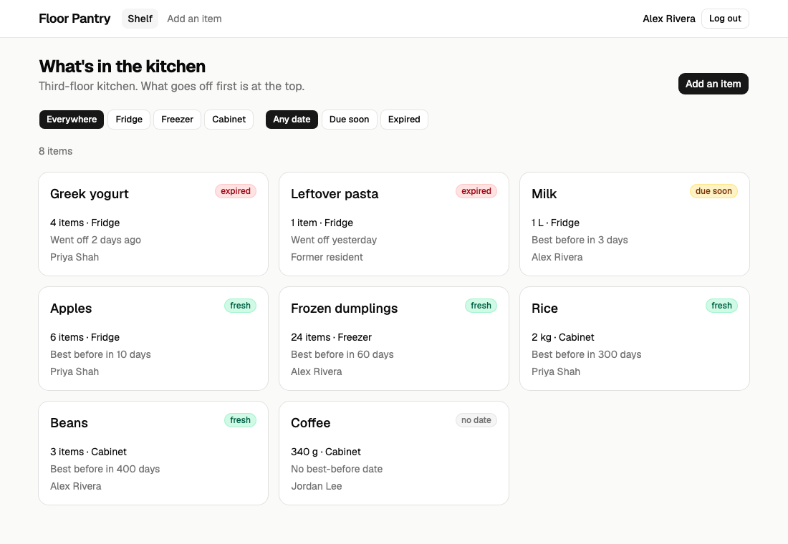
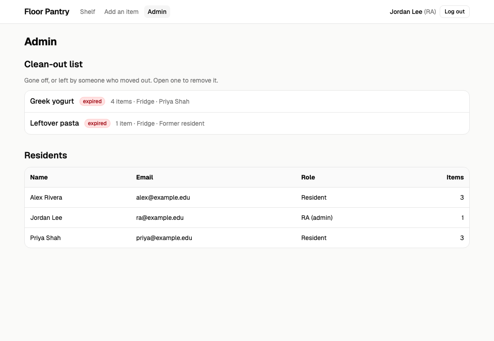

# Pantry example — a final project

This is a sample final project. It is the [midterm example](../pantry-example-midterm/) with a
real back end: a Laravel API, a MySQL database, real log in, and tests at three levels. It shows
the minimum from the [project PDF](../PROJECT_v3.pdf), Part 1.

**Floor Pantry** is a shared list of the food in a residence-hall kitchen. Students add what
they put in the fridge. Everyone can see what goes off first. The RA (the admin) removes old food.



## Run it

```bash
cp .env.example .env
docker compose watch
```

Open **http://localhost:5181**. The first start takes a few minutes. To stop, press Ctrl+C,
then run `docker compose down`.

Each time it starts, the database is emptied and filled with the starting data again.
You can log in with these accounts. The password for each is `password`.

| Email | Role |
|---|---|
| `alex@example.edu` | resident |
| `priya@example.edu` | resident |
| `ra@example.edu` | RA (admin) |

## Run the tests

Leave `docker compose watch` running. In a second terminal:

```bash
docker compose run --rm unit
docker compose run --rm api
docker compose run --rm e2e
```

| Suite | Tool | What it checks | Tests |
|---|---|---|---|
| `unit` | PHPUnit | The rules, with no database: amounts, dates, who may do what, the form rules | 47 |
| `api` | Playwright | Every endpoint: the success case and each error (401, 403, 404, 422) | 30 |
| `e2e` | Playwright | The pages in a browser: shelf, item, form, log in, admin | 20 |

The Laravel service is called `app`. The name `api` is used for the API tests, as in the PDF.

## Run the production image

`docker compose watch` is the development setup: two containers, Vite, MySQL, and a database
that is refilled on every start. The copy that is deployed is built differently
([week 13](../../weeks/week-13.md)): one container holds the React build and the API,
the database is PostgreSQL, and a start keeps the data.

```bash
docker compose -f docker-compose.prod.yml up --build
```

Open **http://localhost:8090**. It starts empty: there is no seeder in production, so register
an account and add the first item. Ctrl+C stops it; the next start still has your data.

| File | What it is |
|---|---|
| [`Dockerfile`](Dockerfile) | The production image, in three stages: build the pages, install the API, what runs |
| [`.dockerignore`](.dockerignore) | What must not be copied into the image (`.env`, `vendor/`, `node_modules/`) |
| [`docker-compose.prod.yml`](docker-compose.prod.yml) | That image next to PostgreSQL, with its settings as environment variables |
| [`.github/workflows/deploy.yml`](.github/workflows/deploy.yml) | The pipeline: tests, then build in Azure's registry, roll the app, check it |
| [`api/routes/web.php`](api/routes/web.php) | The fallback route: any path that is not `/api/*` gets the React app |
| [`api/bootstrap/app.php`](api/bootstrap/app.php) | `trustProxies`: the request arrives through Azure's edge, which holds the certificate |
| [`api/app/Http/Middleware/SecurityHeaders.php`](api/app/Http/Middleware/SecurityHeaders.php) | Week 11's four headers on every response; HSTS tells browsers to use https here from now on |

## Preparing your own project for a production build

The pantry went from `docker compose watch` to a production image with **four new files and
three changed lines**. Your project needs the same changes. [Homework 11](../../homework/hw11/README.md)
walks through them step by step and has the troubleshooting table; this section is the short
version, with the reason for each change.

**1. Add four files.** Copy them from this folder (or from `homework/hw11/starter/`), then read
the comments in each one.

| File | Goes in | Why |
|---|---|---|
| `Dockerfile` | the root, next to `api/` and `web/` | One image: stage 1 builds React, stage 2 installs Laravel without the dev packages, stage 3 runs both with FrankenPHP on port 8080 |
| `.dockerignore` | the root | Keeps your `.env` (secrets), `vendor/` and `node_modules/` out of the image |
| `docker-compose.prod.yml` | the root | Runs that image next to PostgreSQL on your laptop, with its settings passed in as Azure passes them |
| `SecurityHeaders.php` | `api/app/Http/Middleware/` | Week 11's headers, including HSTS |

Your `docker-compose.yml` and `api/Dockerfile` do not change: development keeps working as before.

**2. Change three lines in Laravel.**

| File | Change | Why |
|---|---|---|
| `api/routes/web.php` | Replace the `/` route with the [fallback route](api/routes/web.php) | The React build now sits in `public/`. A refresh on `/items/3` matches no file and no route, so Laravel sends `index.html` and React Router shows the page. Unknown `/api/*` paths still get a JSON 404 |
| `api/bootstrap/app.php` | `$middleware->trustProxies(at: '*');` inside `withMiddleware` | Azure's edge ends https and forwards plain http. Without this line Laravel thinks the visitor used http: its links say `http://` and the session cookie is not marked Secure |
| `api/bootstrap/app.php` | `$middleware->append(\App\Http\Middleware\SecurityHeaders::class);` | Sends the headers on every response |

**3. Check five things that are already right in the pantry, but may not be in your project.**

| Check | Where | Why |
|---|---|---|
| `'debug' => (bool) env('APP_DEBUG', false)` | `api/config/app.php` | Debug comes from the environment and is off unless something turns it on. A stack trace on a public site shows your SQL and file paths |
| `health: '/up'` inside `withRouting` | `api/bootstrap/app.php` | Azure sends visitors to a new version only after `/up` answers 200 |
| Every `fetch()` uses a relative path: `/api/items`, not `http://localhost:8000/api/items` | `web/src/` | In production the pages and the API share one address. Vite's proxy does this job in development only |
| `composer.lock` and `package-lock.json` are committed | `api/`, `web/` | The image installs exactly those versions. Without the lock files the build fails or installs something you never tested |
| A `sessions` table in your migrations | `api/database/migrations/` | Production keeps sessions in the database, because a container's disk does not survive a restart |

**4. Know what is different, on purpose.**

- **Starting the image runs `migrate`, never `migrate:fresh --seed`.** Data is kept between
  starts and deploys. A brand-new production database is empty: register and add a row.
- **PostgreSQL, not MySQL.** Laravel writes the SQL for both, so ordinary migrations run
  unchanged. A raw `DB::statement` written for MySQL may not.
- **No `.env` in the image.** Every setting arrives as an environment variable:
  `docker-compose.prod.yml` sets them on your laptop, and Azure sets them for the deployed copy.

**5. Try it.**

From your repository's root, with the course repo beside it:

```bash
docker compose -f docker-compose.prod.yml up --build
```

Then, in a second terminal (`reviews` is the path of your resource, as in `/api/reviews`):

```bash
bash ../itws2110-course/homework/hw11/check-deploy.sh http://localhost:8090 reviews
```

You should see 8 passed, 0 failed, 3 skipped: the three skipped checks need https, so they
run only on Azure. Then stop the image, start it again without `--build`, and run the check
again. The account from the first run still logs in: a start kept the data.

## What changed since the midterm

| Midterm | Final |
|---|---|
| Fake data in `web/src/fake-server.js` | A Laravel API in `api/` and a MySQL database |
| `request()` in `web/src/api.js` called the fake server | It calls `fetch()`. No page changed |
| No log in | Log in, register and log out, with Laravel Sanctum |
| The rules in `web/src/rules.js` | The rules in Laravel: `api/app/Http/Requests`, `api/app/Policies` |
| "Use some" worked out the amount in the browser | The API works it out: `POST /api/items/{id}/use` (a new endpoint) |
| One list | 20 items a page, with Previous and Next |

## The final checklist

| The PDF asks for | Where it is |
|---|---|
| Register, log in, log out. Two roles | `api/app/Http/Controllers/Api/AuthController.php`, `web/src/pages/AuthPages.jsx` |
| One core resource, belonging to a user | `api/database/migrations/..._create_items_table.php`, `api/app/Models/Item.php` |
| A JSON API: five endpoints | `api/routes/api.php`, `api/app/Http/Controllers/Api/ItemController.php` |
| A React front end, styled with Tailwind | `web/src/` |
| Docker: one command | `docker-compose.yml` |
| Tests at three levels | `api/tests/Unit/`, `web/tests/api/`, `web/tests/e2e/` |
| Deployed at a public URL | Not in this example. Homework 11 does this (started Fri 11/20) |

## Where each part comes from

| Part | File | Source |
|---|---|---|
| The pages, the form, the filters | `web/src/` | The [midterm example](../pantry-example-midterm/) (HW3–HW5) |
| Switching from fake data to `fetch()` | `web/src/api.js` | [Midterm appendix](../MIDTERM_APPENDIX.md), section F |
| Docker for Laravel and MySQL | `api/Dockerfile`, `docker-compose.yml` | HW7 |
| The items table | `api/database/migrations/` | HW7 (migrations) |
| Item belongs to a user | `api/app/Models/` | HW7 (relationships) |
| Loading owners in one query | `ItemController.php` (`with('user')`) | HW7 (the N+1 problem) |
| Starting data | `api/database/seeders/DatabaseSeeder.php` | HW7 (seeders) |
| "You cannot use more than you have" | `api/app/Support/Stock.php` | Week 3 Pantry, `src/Stock.php`, unchanged |
| Expired / due soon / fresh | `api/app/Support/DueDate.php` | Week 3 Pantry, `src/DueDate.php`, unchanged |
| Unit tests for those two | `api/tests/Unit/StockTest.php`, `DueDateTest.php` | Week 3 Pantry, unchanged |
| Form rules and their messages | `api/app/Http/Requests/` | Forms and validation, HW8 |
| Log in and roles | `AuthController.php`, `api/app/Policies/ItemPolicy.php` | Authentication and policies (Fri 10/30), HW8 |
| Limit on log-in tries | `api/app/Providers/AppServiceProvider.php` | Security (Tue 11/3), HW9 |
| JSON responses, Sanctum log in | `api/app/Http/Resources/`, `api/bootstrap/app.php` | APIs (Tue 11/10) |
| React talking to Laravel | `web/src/api.js`, `web/vite.config.js` | API lab (Fri 11/13), HW10 |
| API tests and browser tests | `web/tests/api/`, `web/tests/e2e/` | Week 3 Pantry (Parts 3 and 4), HW2 |

## Beyond the minimum

The PDF asks teams to pick one or two. This example shows three, small:

- **Search and filtering:** filters by place and by date, done by the API, with indexes on those columns.
- **Security:** log in is limited to 20 tries a minute (then 429). The login lives in a cookie, not in JavaScript.
- **Test depth:** every error case of every endpoint has an API test.


