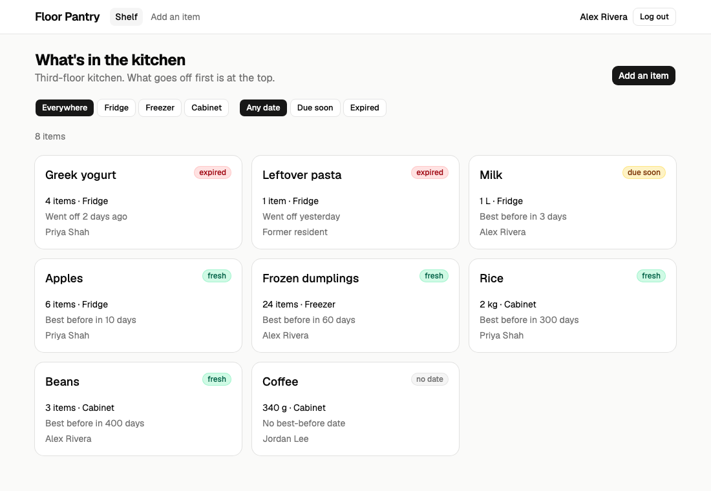
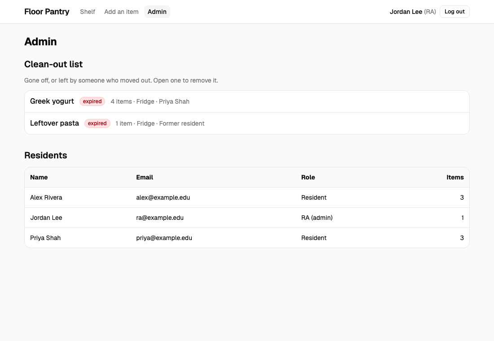

# Pantry example — a final project

This is a sample final project. It is the [midterm example](../pantry-example-midterm/) with a
real back end: a Laravel API, a MySQL database, real log in, and tests at three levels. It shows
the minimum from the [project PDF](../PROJECT_v3.pdf), Part 1.

**Floor Pantry** is a shared list of the food in a residence-hall kitchen. Students add what
they put in the fridge. Everyone can see what goes off first. The RA (the admin) removes old food.



## Run it

```bash
cp .env.example .env
docker compose watch
```

Open **http://localhost:5181**. The first start takes a few minutes. To stop, press Ctrl+C,
then run `docker compose down`.

Each time it starts, the database is emptied and filled with the starting data again.
You can log in with these accounts. The password for each is `password`.

| Email | Role |
|---|---|
| `alex@example.edu` | resident |
| `priya@example.edu` | resident |
| `ra@example.edu` | RA (admin) |

## Run the tests

Leave `docker compose watch` running. In a second terminal:

```bash
docker compose run --rm unit
docker compose run --rm api
docker compose run --rm e2e
```

| Suite | Tool | What it checks | Tests |
|---|---|---|---|
| `unit` | PHPUnit | The rules, with no database: amounts, dates, who may do what, the form rules | 47 |
| `api` | Playwright | Every endpoint: the success case and each error (401, 403, 404, 422) | 30 |
| `e2e` | Playwright | The pages in a browser: shelf, item, form, log in, admin | 20 |

The Laravel service is called `app`. The name `api` is used for the API tests, as in the PDF.

## What changed since the midterm

| Midterm | Final |
|---|---|
| Fake data in `web/src/fake-server.js` | A Laravel API in `api/` and a MySQL database |
| `request()` in `web/src/api.js` called the fake server | It calls `fetch()`. No page changed |
| No log in | Log in, register and log out, with Laravel Sanctum |
| The rules in `web/src/rules.js` | The rules in Laravel: `api/app/Http/Requests`, `api/app/Policies` |
| "Use some" worked out the amount in the browser | The API works it out: `POST /api/items/{id}/use` (a new endpoint) |
| One list | 20 items a page, with Previous and Next |

## The final checklist

| The PDF asks for | Where it is |
|---|---|
| Register, log in, log out. Two roles | `api/app/Http/Controllers/Api/AuthController.php`, `web/src/pages/AuthPages.jsx` |
| One core resource, belonging to a user | `api/database/migrations/..._create_items_table.php`, `api/app/Models/Item.php` |
| A JSON API: five endpoints | `api/routes/api.php`, `api/app/Http/Controllers/Api/ItemController.php` |
| A React front end, styled with Tailwind | `web/src/` |
| Docker: one command | `docker-compose.yml` |
| Tests at three levels | `api/tests/Unit/`, `web/tests/api/`, `web/tests/e2e/` |
| Deployed at a public URL | Not in this example. We do this in the deployment lab (Fri 11/20) |

## Where each part comes from

| Part | File | Source |
|---|---|---|
| The pages, the form, the filters | `web/src/` | The [midterm example](../pantry-example-midterm/) (HW3–HW5) |
| Switching from fake data to `fetch()` | `web/src/api.js` | [Midterm appendix](../MIDTERM_APPENDIX.md), section F |
| Docker for Laravel and MySQL | `api/Dockerfile`, `docker-compose.yml` | HW7 |
| The items table | `api/database/migrations/` | HW7 (migrations) |
| Item belongs to a user | `api/app/Models/` | HW7 (relationships) |
| Loading owners in one query | `ItemController.php` (`with('user')`) | HW7 (the N+1 problem) |
| Starting data | `api/database/seeders/DatabaseSeeder.php` | HW7 (seeders) |
| "You cannot use more than you have" | `api/app/Support/Stock.php` | Week 3 Pantry, `src/Stock.php`, unchanged |
| Expired / due soon / fresh | `api/app/Support/DueDate.php` | Week 3 Pantry, `src/DueDate.php`, unchanged |
| Unit tests for those two | `api/tests/Unit/StockTest.php`, `DueDateTest.php` | Week 3 Pantry, unchanged |
| Form rules and their messages | `api/app/Http/Requests/` | Forms and validation, HW8 |
| Log in and roles | `AuthController.php`, `api/app/Policies/ItemPolicy.php` | Authentication and policies (Fri 10/30), HW8 |
| Limit on log-in tries | `api/app/Providers/AppServiceProvider.php` | Security (Tue 11/3), HW9 |
| JSON responses, Sanctum log in | `api/app/Http/Resources/`, `api/bootstrap/app.php` | APIs (Tue 11/10) |
| React talking to Laravel | `web/src/api.js`, `web/vite.config.js` | API lab (Fri 11/13), HW10 |
| API tests and browser tests | `web/tests/api/`, `web/tests/e2e/` | Week 3 Pantry (Parts 3 and 4), HW2 |

## Beyond the minimum

The PDF asks teams to pick one or two. This example shows three, small:

- **Search and filtering:** filters by place and by date, done by the API, with indexes on those columns.
- **Security:** log in is limited to 20 tries a minute (then 429). The login lives in a cookie, not in JavaScript.
- **Test depth:** every error case of every endpoint has an API test.


