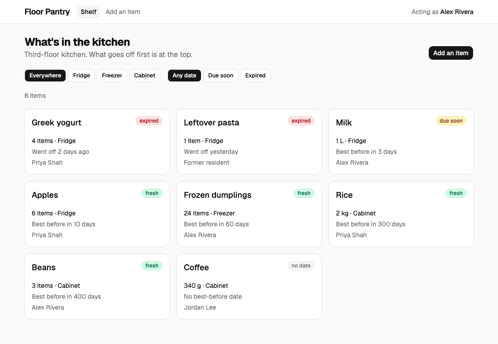

# Pantry example — a midterm project

This is a sample midterm project. It shows what Part 3 of the
[project PDF](../PROJECT_v3.pdf) asks for: a React prototype on fake data, and the API design.
The [final example](../pantry-example-final/) is the same app with a real back end.

**Floor Pantry** is a shared list of the food in a residence-hall kitchen. Students add what
they put in the fridge. Everyone can see what goes off first. The RA (the admin) removes old food.



## Run it

```bash
cp .env.example .env
docker compose watch
```

Open **http://localhost:5181**. To stop, press Ctrl+C, then run `docker compose down`.

There is no log in yet. The midterm does not need it. The app acts as **Alex Rivera**, a
resident. To act as someone else, add this to the address:

| Add | You act as |
|---|---|
| `?as=priya` | Priya Shah, another resident |
| `?as=ra` | Jordan Lee, the RA (admin) |
| `?as=guest` | nobody (not logged in) |

## The midterm checklist

| The PDF asks for | Where it is |
|---|---|
| `docker compose watch` serves the prototype | `docker-compose.yml` |
| Two key pages | `web/src/pages/ShelfPage.jsx` and `web/src/pages/ItemPage.jsx` |
| A way to move between them | `web/src/App.jsx` (React Router) |
| One working form | `web/src/components/ItemForm.jsx` |
| One module for all data | `web/src/api.js` |
| Sections A to C (the API design) | `PROJECT.pptx` |

## Where each part comes from

| Part | File | Source |
|---|---|---|
| The idea: food, amounts, best-before dates | `web/src/rules.js` | Week 3 Pantry (`inclass/wk3/pantry`) |
| "You cannot use more than you have" | `web/src/rules.js` | Week 3 Pantry, `src/Stock.php` |
| Expired / due soon / fresh | `web/src/rules.js` | Week 3 Pantry, `src/DueDate.php` |
| Item cards in a list | `web/src/components/ItemCard.jsx` | HW4 (`PantryCard`) |
| Buttons, inputs, cards | `web/src/components/ui/` | HW4 drill 11 (shadcn/ui) |
| Phone and desktop layout | `web/src/pages/ShelfPage.jsx` | HW3 (grid and breakpoints) |
| Filter buttons | `web/src/pages/ShelfPage.jsx` | HW5 (All / Active / Done) |
| Fake data module | `web/src/api.js`, `web/src/fake-server.js` | [Midterm appendix](../MIDTERM_APPENDIX.md), section A |
| Loading and error messages | `web/src/useLoad.js` | Midterm appendix, section B |
| Form error messages | `web/src/components/ItemForm.jsx` | Midterm appendix, section C |
| Moving between pages | `web/src/App.jsx` | Midterm appendix, section D |
| Docker | `docker-compose.yml` | HW1 and week 3 |
| Who may do what | `web/src/rules.js` | Project PDF, Part 1 |

## Try it

Add one of these to the end of the address:

| Add | What happens |
|---|---|
| `?slow` | Every page loads slowly, so you can see the loading message |
| `?fail` | Every page fails to load, so you can see the error message |
| `?reset` | The data goes back to the start |
